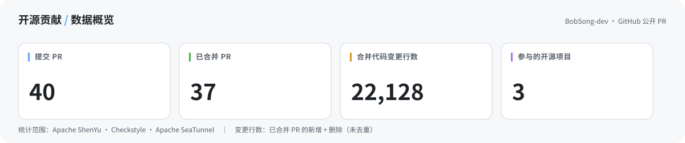
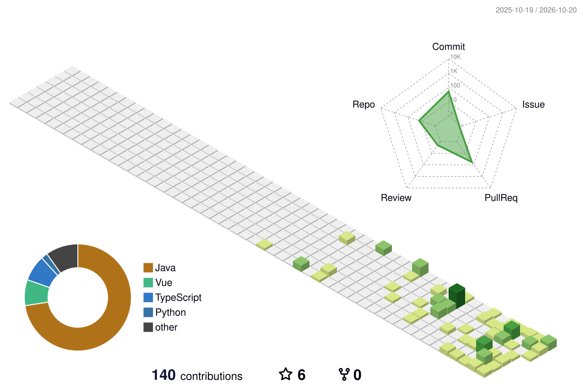

<div align="center">

# 👋 你好，我是 BobSong

**Java 后端开发 · 开源贡献 · AI Agent 工程实践**

<sub>喜欢研究真实的工程问题，也喜欢把想法做成能够运行、能够维护的项目。</sub>

<p>
  <a href="https://github.com/BobSong-dev?tab=followers"></a>
  <a href="https://github.com/apache/shenyu/pulls?q=is%3Apr+author%3ABobSong-dev"></a>
  <a href="https://github.com/checkstyle/checkstyle/pulls?q=is%3Apr+author%3ABobSong-dev"></a>
</p>

</div>

### 🧑‍💻 关于我

目前是一名计算机科学与技术专业的在校生，主要关注 **Java 后端、API 网关、分布式系统**，也在探索 **AI Agent 的工程化落地**。

比起只把功能跑通，我更在意代码的可维护性、问题背后的根因，以及项目能否真正投入使用。

```java
import java.util.List;

public record Developer(
    String github,
    String direction,
    List<String> interests,
    List<String> openSource
) {
    public static Developer bob() {
        return new Developer(
            "BobSong-dev",
            "Java 后端开发与 AI 应用",
            List.of("分布式系统", "API 网关", "AI Agent"),
            List.of("Apache ShenYu", "Checkstyle", "Apache SeaTunnel")
        );
    }
}
```

### 🚀 开源贡献 · 数据概览

<!-- CONTRIBUTIONS:START -->
<picture>
  <source media="(prefers-color-scheme: dark)" srcset="./assets/pr-stats-dark.svg" />
  <source media="(prefers-color-scheme: light)" srcset="./assets/pr-stats-light.svg" />
  
</picture>

| 开源项目 | 提交 PR | 已合并 | 待处理 | 已合并 PR 代码变更量* |
|:--|--:|--:|--:|--:|
| [Apache ShenYu](https://github.com/apache/shenyu/pulls?q=is%3Apr%20author%3ABobSong-dev) | 33 | 32 | 1 | +18,406 / −471 = **18,877** |
| [Checkstyle](https://github.com/checkstyle/checkstyle/pulls?q=is%3Apr%20author%3ABobSong-dev) | 1 | 1 | 0 | +351 / −1 = **352** |
| [Apache SeaTunnel](https://github.com/apache/seatunnel/pulls?q=is%3Apr%20author%3ABobSong-dev) | 1 | 1 | 0 | +33 / −7 = **40** |
| **合计** | 35 | 34 | 1 | +18,790 / −479 = **19,269** |

<sub>* 代码变更量 = 已合并 PR 的新增行数 + 删除行数之和，不代表最终代码库净新增行数。仅统计上表中的三个公开仓库；数据由 GitHub Actions 每日自动更新。</sub>
<!-- CONTRIBUTIONS:END -->

### 🔎 代表性开源贡献

| 技术方向 | 实际贡献 |
|:--|:--|
| **AI Agent Gateway** | [ShenYu #7133](https://github.com/apache/shenyu/pull/7133)：为 Agent Gateway 增加请求级上下文支持；[ShenYu #7424](https://github.com/apache/shenyu/pull/7424)：接入无状态 MCP 工具入口 |
| **请求隔离与安全性** | [ShenYu #7337](https://github.com/apache/shenyu/pull/7337)：修复旧版 MCP 会话中的请求隔离问题；[ShenYu #7049](https://github.com/apache/shenyu/pull/7049)：防止 Mock 表达式出现跨请求上下文泄漏 |
| **高可用与数据同步** | [ShenYu #7358](https://github.com/apache/shenyu/pull/7358)：处理多节点 WebSocket 数据同步问题；[ShenYu #7343](https://github.com/apache/shenyu/pull/7343)：限制 Admin 消息发送队列并清理停滞会话 |
| **Java 代码质量** | [Checkstyle #20342](https://github.com/checkstyle/checkstyle/pull/20342)：修复包含 Tab 时的缩进列计算问题 |
| **数据集成** | [SeaTunnel #11831](https://github.com/apache/seatunnel/pull/11831)：改进 Databend JDBC URL 参数校验 |

### 🛠️ 正在做的项目

<table>
<tr>
<td width="50%" valign="top">

<strong><a href="https://github.com/BobSong-dev/finalexam-agent">finalexam-agent</a></strong>

<p>面向学习与备考场景的 AI Agent 项目，探索多智能体协作、任务编排和可落地的产品体验。</p>

</td>
<td width="50%" valign="top">

<strong>tianze · 规则引擎 × AI</strong>

<p>开发中</p>

</td>
</tr>
</table>

### ⚙️ 技术栈

<p>


</p>

### 📈 GitHub 3D 贡献日历

<picture>
  <source media="(prefers-color-scheme: dark)" srcset="./profile-3d-contrib/profile-night-rainbow.svg" />
  <source media="(prefers-color-scheme: light)" srcset="./profile-3d-contrib/profile-green-animate.svg" />
  
</picture>


